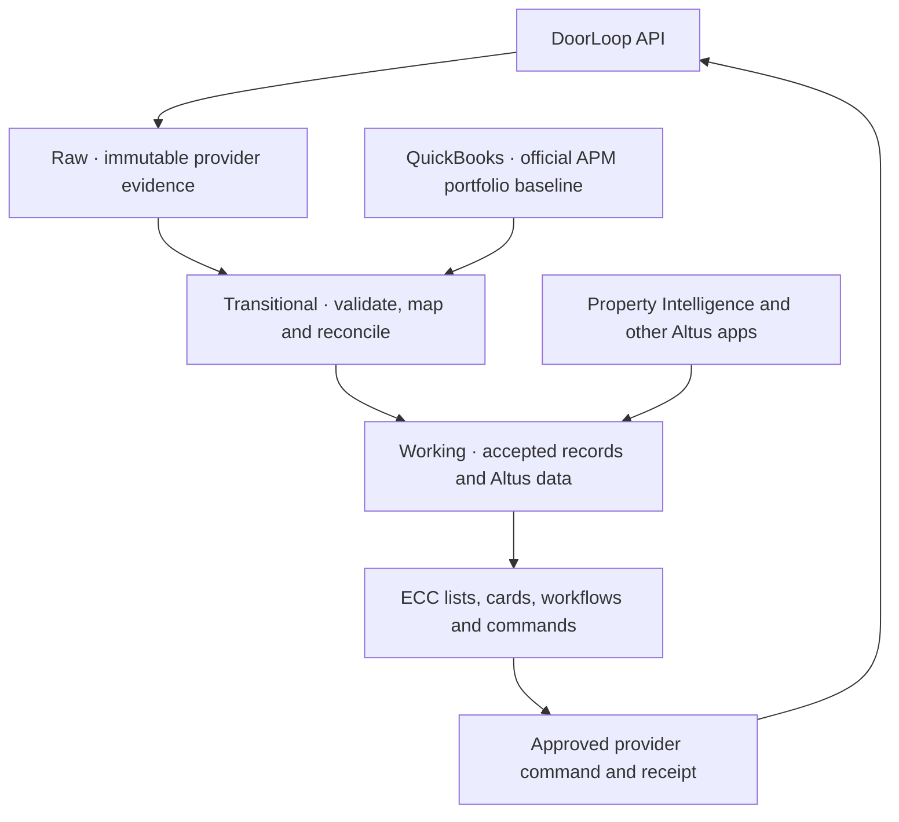

# ECC APM master execution plan

Owner: Dion DePaoli. Execution owner: ECC project lead.
Baseline: November 19, 2026. This is the delivery sequence for the
[approved product master plan](ECC_SUPERIORITY_IMPLEMENTATION_MASTER_PLAN_V1.md).
Its database detail is the [DoorLoop ingestion and UI plan](https://github.com/Altus-Realty-Group/doorloop-sync-backend/blob/main/docs/database/ECC_APM_DOORLOOP_INGESTION_AND_UI_PLAN.md).
Use this document as the starting point for deciding what to build, verify,
and release across the application.

## What working means

ECC shows an operator the complete admitted portfolio, including inactive and
historical assets, and connects property, owner, unit, tenant, lease and
posted ledger records. An operator can edit Altus-owned facts, request or
perform supported DoorLoop changes, inspect the confirmed result, and
follow legal, field, construction, intelligence and deal activity from the
same asset. Coverage and access limits are visible. A domain is complete
only when the source-to-screen or screen-to-source journey is proven in the
actual target runtime.

Use the existing AltusCommandCenter Supabase/PostgreSQL project for three
logical data layers. The existing custody store, ingestion control and
Working foundation already provide the core. Add only the missing pieces
and preserve earlier records, IDs and URLs.

## Data and command flow

| Layer | Grain, ownership and boundary | Implementation |
| --- | --- | --- |
| Raw | One immutable response receipt per connection, operation, request scope and position. Keep exact bytes, digest, observed time and source IDs. Store status, retry/limit evidence and file originals separately from projection. | Reuse `provider_custody`. Existing LIST capture is installed. Complete the property-detail runtime and prove historical enumeration, related endpoints, events, finance periods and attachments independently. |
| Transitional | One accepted or quarantined observation per source identity and version, with field disposition, reviewed mappings, references and coverage. One outbound intent per approved command, with attempts, receipts and reconciliation. | Reuse `ecc_capture` controls and the existing Working validation, field accounting and quarantine records. Use connection-scoped identity mapping. Add only missing command/receipt pieces after checking existing seams. |
| Working | Stable Altus identities, accepted provider current state and history, property-owner/unit/lease/tenant links, scoped read models and independently governed Altus edits. | Use `ecc_working` and approved native ECC relations. Apply parents before children. Stable internal IDs and foreign keys carry through to cards and cross-app links. Retain the original location and source revision for accepted values. |
| Altus-owned data | Notes, classifications, review decisions, documents, legal matters, triage and workflows have an Altus writer and change history. | Reuse existing native domain contracts. Keep Altus data usable when a provider record changes, is stale or disappears. Refresh/replay has no authority to overwrite Altus-owned facts. |

QuickBooks is the official portfolio baseline. The corrected workbook includes
361 accounting directory records, including projects and repeated addresses.
DoorLoop supplies operational identities, relationships and activity status.
Compare both and retain the conflicting evidence until resolved. A QuickBooks
parent account does not establish legal ownership or grant access. A property
missing from a LIST stays unresolved until verified source evidence establishes
its state.

Keep operation-scoped coverage, including active and inactive lists, details,
historical changes, payments, and originals. A completed LIST verifies its own
scope only. Preserve omitted, null, empty and unavailable distinctly. Financial
values use verified exact money units; missing fields cannot become zero.

## Editing and DoorLoop writeback

A screen declares whether an edit is Altus-owned, provider-owned or a
request for an approved provider action. Commit native changes and any
corresponding command intent atomically within the appropriate transaction.
An ECC-owned edit remains durable in ECC. For provider-owned values, Working
retains the last confirmed values while the proposal is visible as pending.

| Step | Required behavior |
| --- | --- |
| 1. Prepare | Bind actor or authorized server job, company, connection, resource, exact native ID, expected revision, operation and allowed field changes. Record intent, reason and idempotency key. |
| 2. Authorize | Verify allowed field and operation contract, current scope, expected revision and approvals where required. Reject conflicts before sending. Protect the provider key on the server. |
| 3. Dispatch | Claim one attempt; apply the existing provider rate budget and backoff. Execute the documented operation on the same bound DoorLoop connection. Capture the response and attempt receipt. |
| 4. Reconcile | Re-read by exact native ID or consume a verified provider receipt. Confirm the resulting state before updating Working. An uncertain response enters reconciliation before any resend. |
| 5. Show outcome | Expose draft, approval, pending, confirmed, rejected, conflict and unknown states with a traceable receipt. Preserve both prior value and proposed delta. Route unsupported operations through a tracked DoorLoop handoff. |

Start with one documented low-risk property edit in a non-production test
scope, chosen after field and operation evidence is verified. Test duplicate
submission, outage after dispatch, stale revision, conflict, denial and
correct readback. Then expand by operation. DoorLoop retains launch control
of posted accounting and payment execution under the
[launch accounting decision](https://github.com/Altus-Realty-Group/doorloop-sync-backend/blob/main/docs/architecture/ECC_LAUNCH_ACCOUNTING_AND_LAYER_DECISION_20261028.md).
The ECC ledger uses confirmed source amounts and distinguishes proposals,
pending processing and settlement.

## UI and read model map

| Surface | Data shown and what works there | Acceptance |
| --- | --- | --- |
| Portfolio and asset cards | Properties across active/inactive history; owner, units, leases, tenants and related records; source and freshness; searchable status and linked cards. | Exact identities and record counts match the admitted Working scope; zero unit counts require a complete related-record read. |
| Dashboard and Data Hub | Counts, exceptions, coverage by source/scope and sync health, including unresolved identities and relationship review. | Correct pending/stale/denied/empty state; trace the selected row or aggregate to its database proof. |
| Ledger, leases and maintenance | Read real accepted relationships and financial facts. Present local edits and supported DoorLoop commands through the same asset context. | Trace amounts and lifecycle to source; confirmed provider writeback refreshes the visible record; denial and conflicts stay visible. |
| Property Intelligence on the asset card | Read the latest authorized CoreLogic-derived Property Intelligence snapshot using an exact canonical property mapping. Show source, observation date and stale or missing state. | One real stored snapshot renders against its verified property. Manual refresh is a separate authorized, budgeted request with a receipt. Opening a card never triggers a paid request. |
| Legal and documents | Native matters, statuses, evidence, linked assets and authorized document versions through the existing Legal and document-registry contracts. | A scoped case and attachment link works; wrong scope or revoked permission denies; legal records survive provider replay. |
| Work and handoffs | Field evidence, construction project status, Deal Room decisions and outbound requests from the asset. | Follow the real handoff through recipient acceptance, failure/retry and return evidence without duplicate records. |

Dev bypass is the immediate preview acceptance target. Bind the preview to
a restricted server-side reader in the verified private environment and
prove that it returns the expected records. Existing bypass supplies UI review
access; a raw payload, provider key or a production-wide service credential
never enters the browser. Production session and resource authorization
receive their own positive and negative acceptance tests. Route contracts stay
compatible with existing portfolio lists/cards during rollout.

## Altus application handoffs

Use governed server APIs and existing owning-app contracts. Prefer a stable
link and accepted read first. Add a command or event only when there is a
verified producer, consumer and receipt. Reuse existing transports and
contracts; a shared integration service is a separate architecture decision.

| App and owner | Direction and minimum handoff | Required proof |
| --- | --- | --- |
| Control Plane · `altus-control-plane` | Control Plane supplies verified session and company membership. ECC owns its property-to-company/connection mapping and exact resource permissions. | Verify both ends in the same environment; wrong scope and revoked authority disclose no record or identifying metadata. |
| Property Intelligence · CoreLogic integration | PI owns normalized observations, mappings, provider execution and spend. ECC reads permitted snapshots and can request bounded refresh through the owning integration. See the [existing PI handoff](../PROPERTY_INTELLIGENCE_MANUAL_REQUEST_HANDOFF_20260928.md). | Confirm the current PI producer, consumer and identity-map contract before binding; one verified ECC property and snapshot with freshness. |
| Field App · `altus-field-app` | ECC sends approved work/inspection scope and canonical asset/work IDs. Field App returns accepted inspection facts, evidence references and status. | Exact asset and work binding, accepted return evidence, retry/dedup and wrong-company denial. |
| Construction Manager · `construction_manager` | ECC sends approved capital-work scope and evidence references. CM owns project schedule, costs and change orders; ECC consumes approved status and completion, with Field App acceptance where required. | Qualifying case creates one project, round-trips state/evidence and preserves approval boundaries. |
| Deal Room · `altus-dealroom-backend` | Deal Room sends approved closing/acquisition onboarding with asset, parties and document references. ECC sends approved disposition context back. | One closing maps to one reviewed ECC asset; an unaccepted or replayed transfer cannot create a duplicate. |
| Price Engine · `price-engine` | Supply approved scenario and underwriting assumptions with source revision; ECC stores the adopted baseline and operating results. | One versioned adoption with no overwrite of actuals or silently updated assumptions. |

For a new handoff specify schema version, exact sender/recipient and scopes,
canonical asset and organization IDs, operation, correlation/idempotency
keys, source time/revision, decision, evidence references, status and
acknowledgement. Negotiate and test compatibility before deploying a changed
producer or consumer. Keep native operational authority with the owning app.

## Delivery order and closure evidence

Work can proceed in parallel for independent source contracts. Roll out producers
before consumers and keep existing adapters compatible until the accepted
replacement passes. No new paid service, recurring vendor job or provider
upgrade is assumed.

| Checkpoint | Owner and work | Proof to close |
| --- | --- | --- |
| 1. Source-backed property card | DoorLoop ingestion + ECC data. Finish the bounded detail runtime and exact source associations. Apply reviewed property/owner/unit contracts for one active and one historical/inactive property in an isolated rehearsal. | Verify retained receipts, accepted relationships, no duplicate/replay drift and visible unresolved edges. Use the aggregate proof tracked in [ingestion PR #138](https://github.com/Altus-Realty-Group/doorloop-sync-backend/pull/138). |
| 2. Preview to Working | ECC runtime + Control Plane where required. Bind the restricted preview reader and existing route contracts to reviewed Working records. Extend from property to owner, unit, lease and tenant. | Exact running revision renders real lists/cards in dev bypass; refresh and page totals match; failed and denied paths disclose no private data. |
| 3. Full inbound portfolio and history | DoorLoop ingestion + ECC reconciliation. Expand known operations, account for all raw fields, reconcile both ownership exports and QuickBooks scope, finish finance/file/history evidence, close or explain every gap. | Coverage matrix has receipts and counts for each scope. Source, admitted Working and UI totals reconcile. Unavailable history is explicit and original bytes remain retrievable by governed evidence path. |
| 4. Controlled round trip | ECC + DoorLoop ingestion. Implement and test the first low-risk writeback plus native edits, then expand by proven operation. | Operator edit -> approved attempt -> exact provider readback -> Working refresh -> UI. Replays, denied permissions, failures and ambiguous responses are proved. |
| 5. PI and Legal | PI owner + ECC Legal/data owners. Bind verified snapshots and scoped matter/documents. | Asset open shows a real PI snapshot and a protected linked matter/document without displacing operating facts. |
| 6. Ecosystem and release | ECC and owning apps. Verify each real handoff, production access, staged deployment and recovery. | Exact producer/consumer/release revisions, role-positive and negative journeys, desktop/mobile acceptance, rollback rehearsal, and observable ongoing capture and reconciliation. |

## Verified starting point

- ECC UI source includes the Properties activity filter ([PR #255](https://github.com/Altus-Realty-Group/ECC-APM/pull/255)).
  The published v1.0 health check last reported `BACKEND_NOT_CONNECTED`
  ([runtime note](https://github.com/Altus-Realty-Group/ECC-APM/pull/253)).
- The [database preflight](https://github.com/Altus-Realty-Group/doorloop-sync-backend/pull/137)
  was executed against the selected Supabase project. Six LISTs were complete
  within their individual scopes. Working had zero promoted rows and the
  detail receipt relation was absent; only the property field accounting
  pilot had recorded rows.
- The November 19 source proof verified 110 properties, 234 units and 37
  owners in the latest checked LISTs. It matched all 109 reported property-owner
  references and found 97 listed properties with a matched unit and owner
  evidence. The 126 units missing their parent from that property LIST still
  need separate evidence. A current LIST is not the full historical roster.
- The protected-read binding is tracked in [ECC PR #254](https://github.com/Altus-Realty-Group/ECC-APM/pull/254).
  Legal/document source and PI handoff source exist. Live activation and
  cross-app delivery receipts are still to be verified.

Record merge, actual deployment and runtime acceptance separately. Before
production writes, pin source SHA, target project/environment, scope, identity,
current migration state and recovery operator. Keep original evidence and
Altus edits during rollback. Pause the affected dispatch/binding and
reconcile unsettled commands before restart.

## Target PRs and UI acceptance ownership

Codex owns release order and final acceptance of every ECC UI surface,
including design, data completeness, accessibility and working actions.
External contributors own one bounded producer slice at a time. A target
PR records scope and proof expectations. Handoff and implementation
completion require their own evidence.

| Sequence | Owner | Target | Acceptance and dependency |
| --- | --- | --- | --- |
| Start now | Grok | [DoorLoop #139](https://github.com/Altus-Realty-Group/doorloop-sync-backend/pull/139), bounded property-detail runtime composition | Private dispatch, shared budget, exact bytes and restart proof over the merged custody and transport seams. Source/isolated proof first. |
| Start in parallel | Claude Code | [DoorLoop #140](https://github.com/Altus-Realty-Group/doorloop-sync-backend/pull/140), Working owners contract | Disabled registry and exact owner-relationship proof, with sensitive fields retained under custody. Independent of #139. |
| Start now | Codex | Properties activity column and UI acceptance in this PR | Active, inactive and unknown are distinguishable on the property table even when showing all records. No network or storage dependency. |
| After producer and authority proof | Codex | [ECC #254](https://github.com/Altus-Realty-Group/ECC-APM/pull/254) and the separately bounded preview binding | Read one active and one inactive property from Working with actual owner and unit links. Verify runtime and denial paths. |
| After the property path | Codex owns UI; produce separate app-owned PRs | Lease/tenant/owner cards, posted ledger, Legal/documents and Property Intelligence | Exact entity links, field coverage, real values and workflow acceptance. Stage each producer before its consumer. |
| After source/readproof for each operation | Codex owns UI; producer PR per operation | ECC edits and DoorLoop writeback; Field App, Construction Manager, Deal Room and Price Engine handoffs | One governed round trip per contract with a receipt, same-ID readback and duplicate/denial recovery. |

### November 19 producer review and pilot gate

| Target | Reviewed head | Hosted result | Release disposition |
| --- | --- | --- | --- |
| [DoorLoop #139](https://github.com/Altus-Realty-Group/doorloop-sync-backend/pull/139) | `77fab4a8524ad28b9671cec19395e5d165666078` | Smoke passed. [PG15](https://github.com/Altus-Realty-Group/doorloop-sync-backend/actions/runs/44620544731) and [PG16](https://github.com/Altus-Realty-Group/doorloop-sync-backend/actions/runs/44620544739) each ran 544 tests and failed the generated writer inventory check. | Draft. Correct source dispatch and regenerate inventory. Installed runtime admission and budget binding require independent proof. |
| [DoorLoop #140](https://github.com/Altus-Realty-Group/doorloop-sync-backend/pull/140) | `3dc589ec24c30c13bdb0c70f08cd4060299ccf12` | Smoke passed. [PG15](https://github.com/Altus-Realty-Group/doorloop-sync-backend/actions/runs/44625131173) and [PG16](https://github.com/Altus-Realty-Group/doorloop-sync-backend/actions/runs/44625131251) each passed 581 tests. | Draft. Make relationship rows and their replay fingerprint use one consistent identity snapshot. |

**Grok, DL-DETAIL v2, continue #139.** Verify the branch and reviewed
head. Require an awaited admission port that verifies and consumes the
server dispatch capability once, returns the bound run and connection,
and denies before custody or transport on failure. Keep process-local
nonce and budget doubles in tests. Exercise shared budget reservation and
provider backoff through one contract for the LIST and DETAIL workers.
The installed capture catalog has dispatch and budget state. Verify the
authorized DETAIL interface before claiming an installed binding. Keep
the Edge entry closed until that interface is proven. Derive IDs from
the server plan. For new and recovered receipts, read back and verify
connection, operation, run, ordinal, requested ID, status, timestamp,
response digest and applicable Retry-After. Match IDs with strict UTF-8
and duplicate-key rejection. Prove asynchronous admission denial, restart
and concurrent replay, changed receipt metadata and malformed control
responses. Regenerate the writer inventory. Reconcile with main and
report the new head and its hosted results. Source and isolated tests
only.

**Claude Code, WORK-OWNERS v2, continue #140.** Verify the branch and
reviewed head. A promoter can commit an identity between the fingerprint
query and the insert in `link_property_owners`. The link-only advisory
lock does not cover that promoter. Materialize the exact reference
resolution once per generation and derive both its fingerprint and
inserted rows from that result. Verify that a concurrent owner or
property arrival leaves the stored fingerprint, quarantine and link
state consistent and that a replay creates a new generation only when
resolution actually changes. Preserve the disabled registry, immutable
history, custody-only sensitive fields, and connection-scoped metadata
boundary. Reconcile with main and report exact-head PG15 and PG16 proof.
Source and isolated tests only.

**Codex owns the runtime and UI acceptance.** First prove both producer
seams in isolation. Bind the approved Working and capture capabilities
in the selected environment, then rehearse a known active and a known
inactive property through protected Working reads. Compare the rendered
asset cards with source receipts, actual owner and unit edges and the
QuickBooks reconciliation status. Keep unmatched source references visible
and separately count records shown, records withheld by scope and provider
coverage still unverified. A two-record pilot proves the path. Portfolio
completion requires independent reconciliation of the full active and
historical population with the QuickBooks baseline and every accessible
DoorLoop source scope.

### UI data coverage before release

Every admitted field must have a recorded surface or an authorized
evidence path. For each surface and field record the owning source,
identity or relationship join, meaning, unit/format, freshness,
display location and empty/stale/conflict behavior. Require the field's
render or evidence proof before calling the domain complete. Sensitive
and unresolved fields stay accessible only through their approved scope.
Collected provider fields, Altus-native fields, QuickBooks portfolio
evidence and PI observations keep their distinct provenance.

Use the list for scanning, the card for the full asset view, and detail
panels for documents, history and raw evidence. Show useful operating
indicators and next actions that reconcile to approved records. Group
details around the operator's work, rather than dumping JSON into the
table. Keep status, source and discrepancy visible when they affect a
decision. Null, zero, missing, stale, denied and conflict each have
honest presentation.

Review the real desktop and mobile flows in the selected runtime.
Check keyboard and touch, readable tables and charts, search and filters,
card links, successful and failed edits, reload, and explicit source
coverage. Use Altus black, white and gold and the existing route and
component patterns. Written proof pairs the visible result with the
accepted source record or receipt and exact deployed revision.
